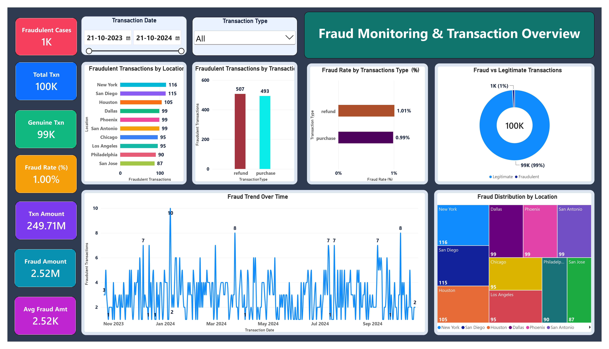
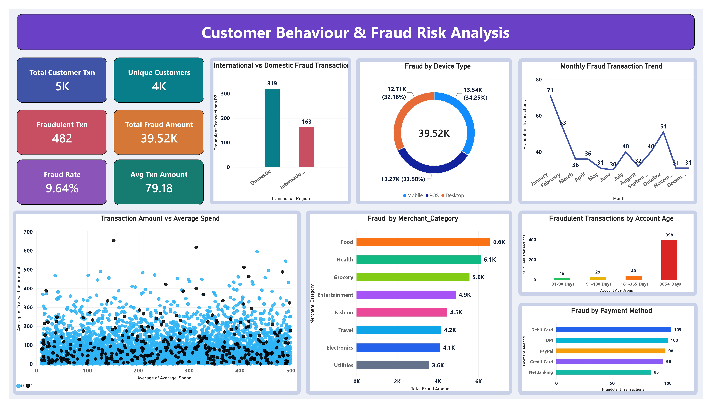
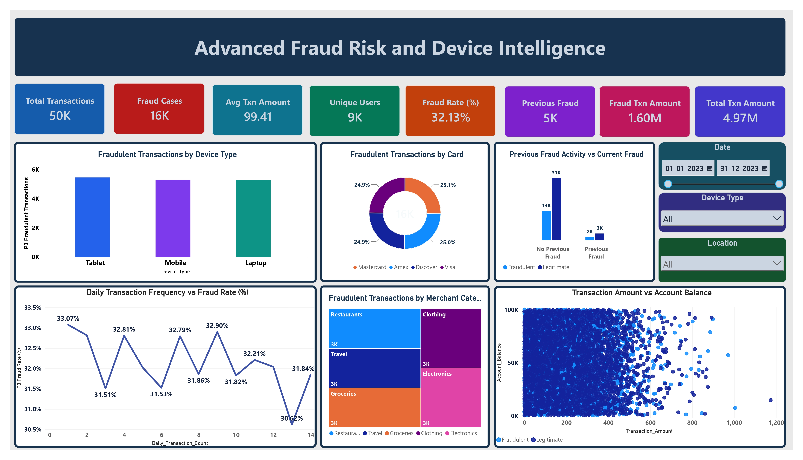
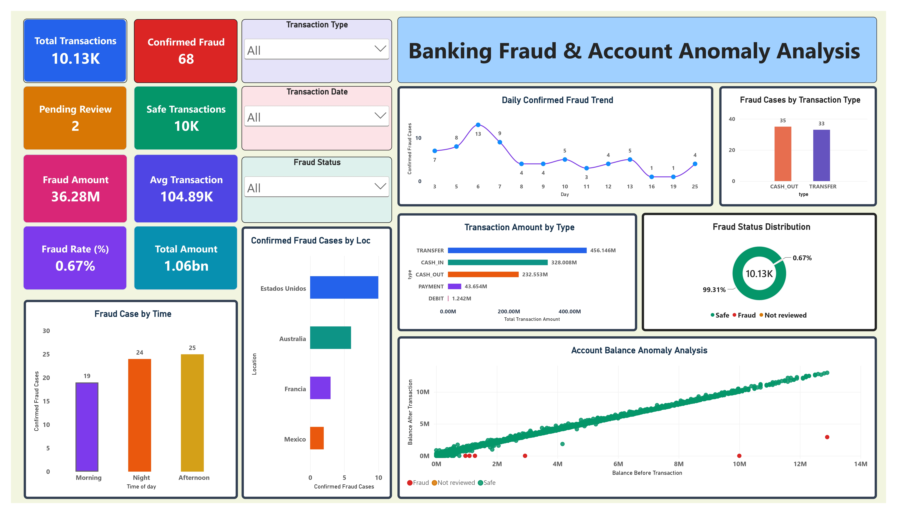

# Financial-Fraud-Detection-and-Analytics-Using-Power-BI
A financial fraud analytics project built with Power BI, DAX, Power Query and Excel. It includes four interactive dashboard pages covering transaction monitoring, customer fraud risk, device intelligence and banking account anomalies.

# 🛡️ Financial Fraud Detection & Analytics

### Interactive Fraud Monitoring, Risk Analysis & Account Anomaly Intelligence

---

## 📌 Project Overview

**Financial Fraud Detection & Analytics** is a business intelligence project designed to explore suspicious financial transactions, understand fraud patterns and support data-driven investigation.

The project transforms transaction datasets into a **four-page interactive Power BI dashboard**. It examines transaction activity, customer behaviour, payment methods, device and card usage, past fraud history, and account-balance anomalies.

The four pages use **different datasets**. Their totals and fraud rates describe separate analytical populations and should not be combined into a single overall fraud rate.

### 🎯 Project Objectives

- Monitor transaction volumes, fraudulent cases, monetary exposure and fraud rates.
- Examine fraud by transaction type, location and time.
- Understand customer and payment-related fraud patterns.
- Analyse device usage, card types and previous fraud activity.
- Explore unusual before-and-after account balances.
- Present interactive KPIs and visual insights for investigation and reporting.

---

## 🚀 Key Features

### 📊 1. Fraud Monitoring & Transaction Overview

- Transaction, fraudulent and legitimate counts.
- Total and fraudulent transaction amounts.
- Fraud comparisons across locations and transaction types.
- Transaction trends over time and fraud-distribution visuals.

### 👥 2. Customer Behaviour & Fraud Risk Analysis

- Customer transaction counts, unique customers and fraud rates.
- International versus domestic transaction analysis.
- Fraud comparisons by device, account age and payment method.
- Merchant-category insights and monthly fraud trends.

### 💻 3. Advanced Fraud Risk & Device Intelligence

- Fraudulent transactions by device and card type.
- Current fraud classification versus previous fraud activity.
- Fraud rate by daily transaction frequency.
- Merchant-category treemap and transaction-amount/account-balance scatter plot.

### 🏦 4. Banking Fraud & Account Anomaly Analysis

- Confirmed fraud, safe transactions and pending-review status.
- Reviewed-transaction fraud rate and monetary exposure.
- Fraud by transaction type, location and time of day.
- Account balances before and after transactions, with status-based scatter colors.

---

## 🛠️ Technology Stack

| Technology | Purpose |
| --- | --- |
| **Microsoft Power BI Desktop** | Interactive dashboards and data visualisation |
| **DAX** | Measures for transaction counts, amounts and fraud rates |
| **Power Query** | Data cleaning, type conversion and fraud-status preparation |
| **Microsoft Excel** | Source transaction datasets |
| **Git & GitHub** | Repository hosting and project documentation |
| **Word / PDF** | Project report and submission documentation |

> **Scope note:** This project demonstrates Power BI-based analytics. A deployed machine-learning fraud prediction model is not established by the dashboard export; it is listed under Future Scope.

---

## 🏗️ System Architecture

The project follows a structured reporting workflow, transforming source transaction data into interactive fraud analytics.

```text
         TRANSACTION DATASETS (EXCEL)
    ┌────────────────────────────────┐
    │ Credit card transactions       │
    │ Customer fraud transactions    │
    │ Synthetic fraud transactions   │
    │ Banking and account records    │
    └───────────────┬────────────────┘
                    │
                    ▼
    ┌────────────────────────────────┐
    │ Power Query                    │
    │ Types, cleaning, status labels │
    │ and missing-value checks       │
    └───────────────┬────────────────┘
                    │
                    ▼
    ┌────────────────────────────────┐
    │ Power BI Data Model + DAX      │
    │ Fraud counts, rates, amounts   │
    └───────────────┬────────────────┘
                    │
                    ▼
    ┌────────────────────────────────┐
    │ 4 Interactive Dashboard Pages  │
    │ KPIs, trends, charts, slicers  │
    └───────────────┬────────────────┘
                    │
                    ▼
    ┌────────────────────────────────┐
    │ Insights and Risk Investigation│
    └────────────────────────────────┘
```

---

## 📂 Dashboard Pages

The Power BI report contains **four interactive dashboard pages**.

| No. | Dashboard | Description |
| --- | --- | --- |
| 1 | Fraud Monitoring & Transaction Overview | High-level fraud cases, amounts, trends and locations |
| 2 | Customer Behaviour & Fraud Risk Analysis | Customers, payment methods, merchant and device risk |
| 3 | Advanced Fraud Risk and Device Intelligence | Devices, card types, previous history and account-balance relationships |
| 4 | Banking Fraud & Account Anomaly Analysis | Confirmed fraud, pending reviews, account balances and transaction types |

---

## 📊 Dataset Overview

The following **displayed metrics** come from the four-page dashboard export. Counts abbreviated with K/M/bn are rounded as shown in Power BI.

| Metric | Page 01 | Page 02 | Page 03 | Page 04 |
| --- | ---: | ---: | ---: | ---: |
| Transactions | 100,000 | 5K | 50K | 10.13K (10,127) |
| Confirmed/Fraud Cases | 1,000 | 482 | ~16K | 68 |
| Fraud Rate | 1.00% | 9.64% | 32.13% | 0.67% |
| Total Transaction Amount | 249.71M | — | 4.97M | 1.06bn |
| Fraud Transaction Amount | 2.52M | 39.52K | 1.60M | 36.28M |
| Other KPI | 99K genuine | ~4K unique customers | ~9K unique users | 2 pending review |

**Important:** Each page uses a different dataset, so cross-page rates and monetary values are not directly comparable. Currency units are omitted because a consistent currency was not established in the supplied dashboard export.

---

## 🔍 Key Business Insights

### 1. Transaction Monitoring

- Page 01 reports **1,000 fraudulent cases among 100,000 transactions**, or **1.00%**.
- Fraud activity can be investigated by transaction type, time and location.
- The dashboard shows **249.71M** in total transaction value and **2.52M** in fraudulent transaction value.

### 2. Customer Fraud Behaviour

- Page 02 reports **482 fraudulent transactions** and a **9.64% fraud rate** in its separate dataset.
- Fraud varies across payment methods, transaction region and customer account-age groups.
- The available visuals support further investigation of merchant and device patterns.

### 3. Device and Previous-Fraud Patterns

- Page 03 reports a **32.13% fraud rate** in its synthetic analytical dataset.
- Device and card-type comparisons help identify where flagged transactions occur.
- Previous-fraud history can be examined alongside current fraud status; the visual alone does not establish causality.

### 4. Banking Account Anomalies

- Page 04 contains **10,127 transaction records**, including **68 confirmed fraud cases** and **2 pending reviews**.
- Transaction amounts and fraud counts can be compared across types, time periods and locations.
- Before-and-after account-balance scatter plots help identify potential outliers, which require investigation rather than automatic fraud classification.

---

## 💡 Business Recommendations

1. **Prioritise confirmed cases:** Review known fraudulent transactions and investigate associated patterns.
2. **Track unreviewed cases separately:** Do not classify pending reviews as either safe or fraudulent.
3. **Focus investigations by segment:** Compare fraud rates as well as fraud counts across transaction types and channels.
4. **Review balance anomalies:** Compare account-balance changes against amount, transaction type and status.
5. **Improve monitoring:** Use refreshed datasets, consistent labels and validated KPI definitions to support ongoing analysis.

---

## ⚙️ Methodology

The project follows a structured analytics workflow.

**Step 1: Data Preparation**

- Imported Excel transaction datasets into Power BI.
- Checked data types, missing values and relevant transaction identifiers.
- Used Power Query to standardise text and prepare fraud-status categories.
- Retained **Safe**, **Fraud** and **Not reviewed** as distinct classifications where applicable.

**Step 2: Exploratory Data Analysis**

- Compared fraud counts and transaction amounts by time, location and transaction type.
- Examined customer, device, card and merchant characteristics.
- Reviewed account-balance distributions and possible outliers.

**Step 3: DAX Measures**

- Created measures for transaction counts and monetary totals.
- Calculated fraudulent and safe transaction counts using filtered DAX measures.
- Used reviewed cases as the denominator for the Page 04 confirmed fraud rate.

```dax
P4 Total Banking Transactions =
COUNTROWS('Banking_Fraud')

P4 Confirmed Fraud Cases =
CALCULATE(
    COUNTROWS('Banking_Fraud'),
    'Banking_Fraud'[Fraud Status Clean] = "Fraud"
)

P4 Confirmed Fraud Rate (%) =
DIVIDE(
    [P4 Confirmed Fraud Cases],
    [P4 Confirmed Fraud Cases] + [P4 Safe Transactions],
    0
)
```

**Step 4: Dashboard Development**

- Designed four Power BI dashboard pages with KPI cards and visualisations.
- Added slicers for interactive investigation.
- Used status-specific colors to distinguish confirmed fraud, safe and unreviewed activity.

**Step 5: Validation**

- Compared chart outputs with displayed KPI measures.
- Reviewed labels, display units, filtering behaviour and category definitions.
- Treated visually unusual transactions as leads for investigation rather than confirmed fraud without a matching status.

---

## 📌 Challenges Faced

- Handling missing account identifiers and transaction-type values without deleting valid data.
- Separating confirmed fraud from unreviewed transactions in DAX.
- Avoiding misleading rounding (for example, large-unit labels on small fraud counts).
- Reducing overplotting in dense scatter charts.
- Maintaining consistent chart colors, titles and readable labels across four pages.
- Interpreting different dataset populations without comparing their fraud rates as if they came from one source.

---

## 🔮 Future Scope

- Evaluate supervised fraud-classification models against held-out data.
- Introduce transaction-level risk scoring and anomaly alerts.
- Add configurable review queues and investigation outcomes.
- Schedule automated data refresh in supported Power BI environments.
- Document data dictionaries, validated measures and source lineage.
- Consider role-based access and privacy controls for sensitive transaction records.

---

## 📸 Dashboard Preview

### Page 01 — Fraud Monitoring & Transaction Overview



### Page 02 — Customer Behaviour & Fraud Risk Analysis



### Page 03 — Advanced Fraud Risk and Device Intelligence



### Page 04 — Banking Fraud & Account Anomaly Analysis



> Upload the `screenshots` folder alongside `README.md` so that these images display correctly on GitHub.

---

## 🌐 Project Links

| Resource | Link / Status |
| --- | --- |
| GitHub Repository | https://github.com/imshoaib21/FraudShield-Financial-Fraud-Detection-Analytics|
| Live Deployment | https://fraudshield-financial-fraud-detecti.vercel.app/ |
| Demo Video | Add link when available |
| Project Report | [View Project Report](Financial%20Fraud%20Detection%20Report.pdf) |
| Power BI Dashboard (`.pbix`) |[Download PBIX File](Fraud%20Detection.pbix) | 
---

## 👨‍💻 Author

**MD SHOAIB AKHTAR**  
MBA — Business Analytics  
Data Science & Analytics Intern

**Mentor:** Chandan Mishra

---

## 🏁 Conclusion

**Financial Fraud Detection & Analytics** demonstrates how Power BI, Power Query and DAX can turn transaction data into interactive fraud-monitoring insights. Across four dashboards, the project analyses fraud cases, customer behaviour, device patterns and banking account anomalies.

The report provides a foundation for more consistent monitoring and further investigation, with potential extensions into validated fraud prediction, automated alerts and operational risk review.

---

⭐ **If you find this project useful, consider giving the repository a star!**
